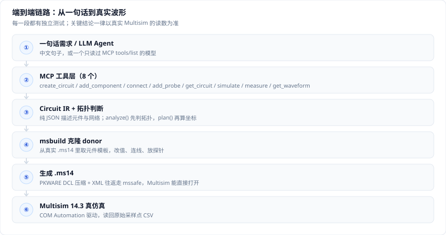
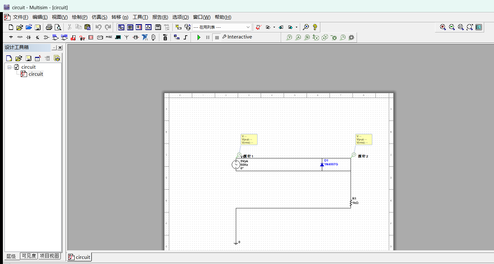
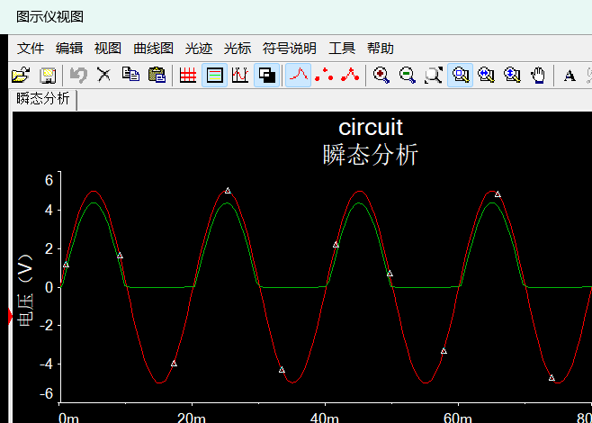
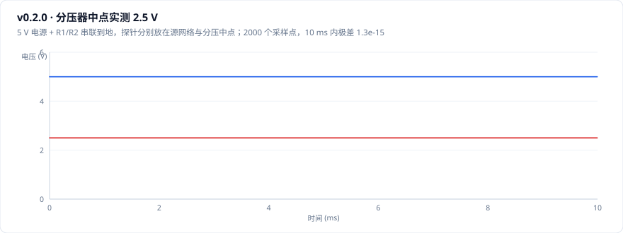
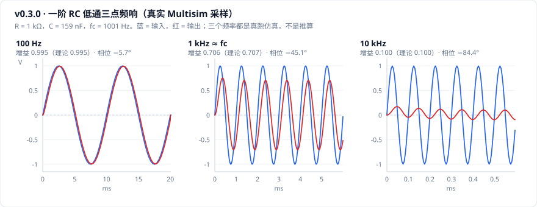
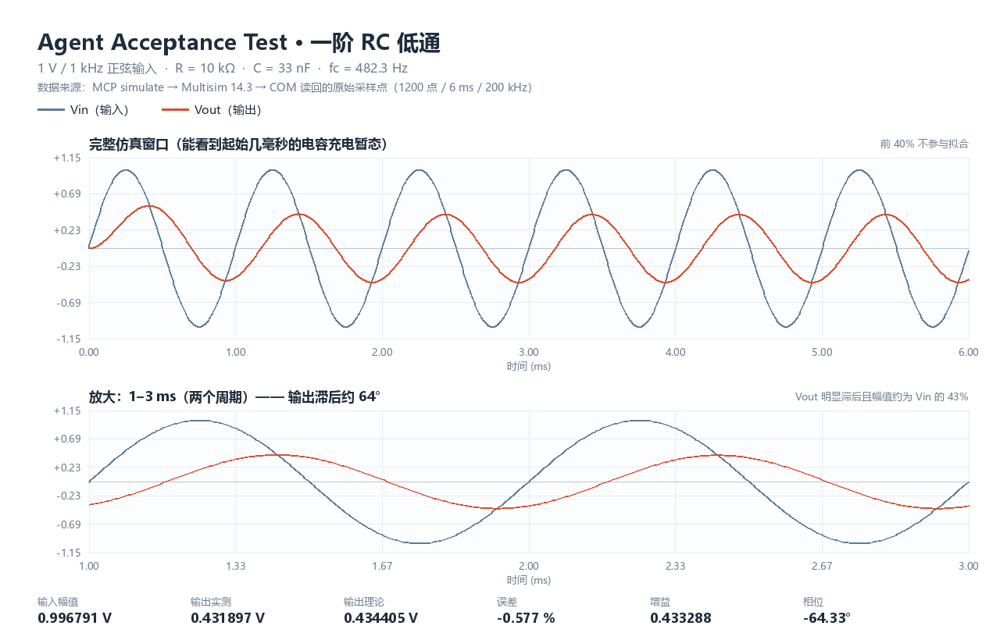
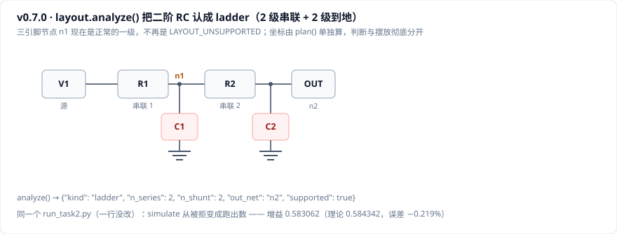
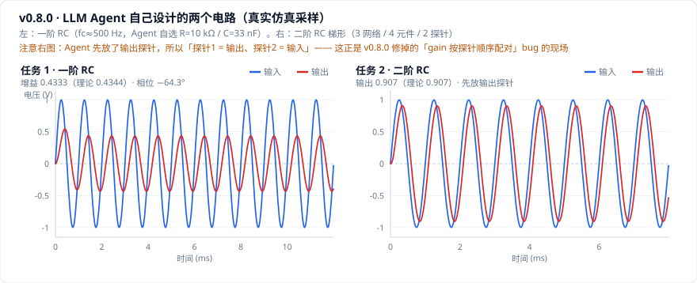
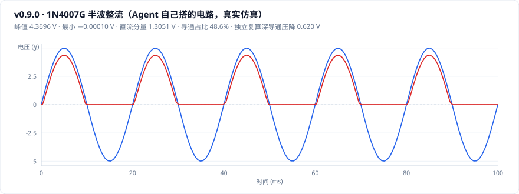

# Multisim 14.3 AI 自动化

**不用鼠标。用代码从空白画布生成 Multisim 电路，让 LLM Agent 自己设计、在真实 Multisim 里仿真、把波形取回来对账。**







<sub>↑ v0.9.2：一个只读过 8 个 MCP 工具说明、看不到源码的 LLM Agent，自己选元件、自己连线。Multisim 14.3.3 真实打开、真实仿真、真实窗口截图 —— 全程没有人工点过一下鼠标。</sub>

---

## 这项目在干嘛

NI 官方的 COM API 能跑仿真、能读波形，**但不能放元件、不能拉导线、不能加探针** —— 也就是说它没法"从零画一个电路"。

所以主线是逆向 `.ms14` 文件格式：它是个 PKWARE DCL 压缩容器，里面装电路 XML。破解之后就能纯代码生成电路文件，再交给 Multisim 打开仿真。在这之上包一层 MCP，任何 Agent 都能一步步建电路。

一句话验收标准（用户原话）：

> **"不要让 AI 把'找到 API'当成果，要把'生成一个全新的、能在 Multisim 里打开的真实电路'作为唯一的核心验收标准。"**

---

## 现在能做什么（v0.9.2，全部真机实测）

| | 现状 |
| --- | --- |
| 入口 | 中文一句话 / Circuit IR（纯 JSON）/ MCP 工具（8 个） |
| 元件 | 5 种基础件（R / C / DC / AC / GND）+ `DIODE/1N4007G` + 探针 |
| 拓扑 | 串联链、分压、旁路、T 型、梯形（≤4 级）、半波整流。**并联支路明确拒绝，不硬排** |
| 出图 | 生成 `.ms14` → Multisim 能打开 → 真仿真 → COM 读回原始采样点 |
| 取数 | 增益 / 相位 / 峰值 / 直流分量 / 导通压降，附独立复算与偏差 |
| 依赖 | **零第三方库**。编解码、XML、GUI、拟合全是标准库 |
| 测试 | 315 项纯逻辑测试，不需要装 Multisim（见文末） |

`registry/components.json` 里扫出了 **192 种**元件，但 `enabled` 闸门只放开了 1 种。
**"目录里有" ≠ "支持"** —— 放开一种元件要做三件事：加 `enabled`、有布局模板、有测试。

---

## 六个真正有突破的版本

其余版本只是常规推进，完整清单见 [Releases](https://github.com/A3-77/multisim-14.3-ai-automation/releases)。

### v0.2.0 · 生成的电路第一次真的能仿真

前面所有"电路打不开 / 电阻像开路 / 只有电源在动"的怪现象，根因只有一个：
`CIITDiagram@SimState` 是个**多行**属性，XML 规范要求属性值里的换行归一化成空格，
`ElementTree` 老实照做 → 仿真配置被压平 → Multisim 读不回来。

修法是所有 XML 读写走 `mssafe`（换行换占位符，序列化后还原），回归测试守住"4 个原生样本往返逐字节一致"。



分压器中点读到 **2.5 V**（电源 5 V，2000 点极差 1.3e-15）—— 这证明电阻真的进了 SPICE 网表并导通，
而不是"电源还在、其余全断"。

### v0.3.0 – v0.4.0 · 从"能拼电路"到"一句话出电路"

v0.3.0 立起两层可复用的东西：统一的 `add_part(family, part, refdes, value=...)`（调用方不碰任何 XML ID），
和 Circuit IR（纯 JSON 描述"有哪些元件、谁连谁、探针放哪"，里面没有任何 Multisim 概念）。

v0.4.0 在最上面接了一句中文。解析器是**规则引擎，不是 LLM** —— 同一句话必须永远解析成同一份 IR，
否则下游不可复现、回归无从谈起。缺参数、并联、白名单外元件，一律报错，**不猜**。



一阶 RC 三点频响全部对上理论（增益 0.995 / 0.706 / 0.100）。三点连成斜率，说明电容真的在参与 ——
如果数据是编的，增益会是一条平线。

### v0.6.0 – v0.6.1 · 从"脚本"变成"Agent 能调的工具"

把焊死的一步一步拆成 **8 个有状态关系的 MCP 工具**（建电路 / 加元件 / 连线 / 加探针 / 查状态 / 仿真 / 测量 / 取波形）。
分两层：`mcp_server.py` 只做 JSON-RPC 收发，`circuit_session.py` 才是业务层（句柄、语义参数、自动网络命名、自动布局、结构化错误）。
会话层能单独测，不需要 Multisim。

**Agent 永远看不到 Multisim。** 传的是 `value=1.0, frequency=1000`，不是 `params={5: 1000.0}`；
不传坐标，布局按拓扑自己算；错误带 `code` / `hint` / `context`，是给 Agent 自纠用的。

第一次外部验收（v0.6.1）：一个只读过 `tools/list` 的 Agent，拿到"设计 fc≈500 Hz 的一阶 RC 低通"，
自己选了 R=10 kΩ / C=33 nF，**13 次调用零错误一次通过**，幅值误差 −0.577%，还用纯标准库从原始 CSV 独立复算出同一个增益。



### v0.7.0 – v0.8.0 · 二阶电路 + 真 LLM 自己跑

v0.7.0 把布局拆成两步：`analyze()` 纯图论判拓扑（不认识坐标），`plan()` 只算坐标（不认识电路语义）。
二阶 RC 梯形从 `LAYOUT_UNSUPPORTED` 变成跑出数，增益误差 −0.219%。



v0.8.0 换成一个真正的 LLM 来跑：5 个任务、**128 次工具调用、11 次真机仿真**，
3 次故意注入的错误全部一次自愈，0 次重复同类错误。

更值钱的是它挖出**三个脚本测试永远碰不到的 API 缺陷** —— 都是"返回结构看起来对，其实方向是反的"：

| 缺陷 | 后果 |
| --- | --- |
| `measure` 的 gain 按**探针添加顺序**配对 | 先放输出探针 → `gain = 1/真值`、相位反号，而 `mode="ratio"` 看起来很权威 |
| `simulate.start` 静默失效 | 传了不报错也不生效，启动暂态混进拟合窗 |
| `topology.supported` 混了两件事 | "布局不会摆"和"线没接完"分不清 |



### v0.9.0 · 元件信息从"手写"变成"从文件里读"

之前支持哪些元件是**代码里的字面量**，加一种要改三处。v0.9.0 改成离线扫 128 个真实 `.ms14`，
抽出 192 种元件的引脚名 / 引脚几何 / SPICE 模板 / donor 来源，**一个字段都不是手写的**，
中间隔一道 `enabled` 闸门。

这一轮只放开 `DIODE/1N4007G` + 半波整流一种拓扑，把它从 Agent 一路验到真机波形：



14 次调用 0 失败。输出峰值 4.3696 V、直流分量 1.3051 V；独立复算深导通压降 0.6200 ± 0.0036 V。
顺手挖出两个被上一轮掩盖的问题：第二个探针其实落在二极管阴极（别人的网络）上；恒定压降模型只在深导通区成立，
所以理论值改成给**区间**而不是点值。

### v0.9.1 – v0.9.2 · 眼见为实

v0.9.1 补上真实 GUI 截图链路（`PrintWindow` 抓真实窗口位图，不是 API 渲染），
过程中定位了 5 个"看起来能跑、其实没生效"的缺陷 —— 参数写进了隐藏控件、`WM_GETTEXTLENGTH` 常量搞反、
125% DPI 下点列表偏一行、菜单点不中偏 14px、图示仪最大化后横轴被切。

v0.9.2 让 Agent 做完整设计题：**61 次调用 / 0 失败 / 4 次真机仿真**，三个 Case 全 PASS。

| Case | Agent 的设计 | 判定 |
| --- | --- | --- |
| A | 一阶 RC，自选 R=1 kΩ / C=318.3 nF | PASS · Level 3 |
| B | 1N4007 半波整流，5 V / 50 Hz | PASS · Level 3 |
| C | 两级 RC，第一次增益 0.3325 **FAIL**，自己算出公式错了、改参数重来 → 0.699086 | PASS · **Level 4** |

Case C 那次自我修正是这一版的重点：它算的是两级同参数级联 `|H| = 1/3`，而不是"单级 0.707 相乘"，
实测 0.3325 与理论 1/3 只差 0.2% —— 说明是设计公式错，不是仿真或测量错。

---

## 30 秒上手

```bash
cd multisim-ctrl

# 1. 解压语料库（108 个官方样例的明文 XML，ground truth）
mkdir -p /tmp/corpus && gunzip -k corpus/samples/PowerSupply.xml.gz -c > /tmp/corpus/PowerSupply.xml

# 2. 读一个样例，看结构
python - <<'PY'
import sys; sys.path.insert(0, "tools")
import msmodel, json
c = msmodel.Circuit.from_xml_file("/tmp/corpus/PowerSupply.xml")
print(json.dumps(c.summary(), ensure_ascii=False, indent=1))
PY

# 3. 生成验收电路并让 Multisim 打开
python tools/build_acceptance.py
python tools/verify_open.py out/ref/acceptance.ms14 out/verify.json

# 4. 一句话生成电路并仿真（COM 必须 32 位 Python）
runtime\py32\python.exe tools/nl_run.py --file examples/nl/rc_lowpass.txt

# 5. 起 MCP server，给 Agent 用
runtime\py32\python.exe -u tools\mcp_server.py
```

**接手前先读两份**：[docs/deadends.md](docs/deadends.md)（死路清单，能省几十小时）和
[docs/next-steps.md](docs/next-steps.md)（按优先级排好的待办）。

---

## 已验证 / 未验证

### ✅ 真机实测通过

- `.ms14` 编解码往返一致；XML 无损往返逐字节一致（`test_mssafe` 4/4）
- 从空白电路生成分压器，中点实测 **2.5 V**；生成 V-R-C-GND 串联链，读数与理论一致
- 原生 555 / 运放电路经本仓库读写后，8 个输出读数与原文件完全一致
- 纯代码生成探针，多探针可区分：`['V(探针1)', 'V(探针2)']`
- 一阶 RC 三点频响、二阶 RC 梯形、直流静态电路、二极管半波整流 —— 全部对上理论
- MCP 8 工具走真实 JSON-RPC 协议，结果与中文链路**逐位相同**
- 中文 → IR → 仿真 → 拟合，端到端真跑 Multisim，与手写 API 基线 Δ=0
- LLM Agent 自主设计三个电路（v0.9.2），含一次自我修正

### ⬜ 明确不支持（不要当成已支持）

- **另外 191 种 donor**：只是"目录里有"，没放开、没模板、没测试
- **二极管的其它拓扑**：桥式、带滤波电容、续流、钳位 —— 全部明确拒绝并给出拒绝码
- **BJT_NPN**：ComponentSpec 层可直接复用，但 layout 层建立在两端元件假设上，需要重写
- **真正的并联支路 / 并联到地 / 反馈 / 桥接**：网表能表达，缺的是"怎么摆才看得懂且不穿符号"
- 主干超过 4 级、多电源、运放 / 555 的通用 `add_part`

### ❓ 已知未知

- `.ms14` 里 `&UNI..._uc<hash>` 的单位哈希表（只实测了电阻、电压两个值）
- 探针序号超过 9 时的命名方式

---

## 文档

| 文档 | 内容 |
| --- | --- |
| [docs/deadends.md](docs/deadends.md) | **死路清单 + 避坑指南**（必读） |
| [docs/ms14-format.md](docs/ms14-format.md) | `.ms14` 格式规范：DCL 压缩算法 + 分块容器 + 字节细节 |
| [docs/circuit-xml.md](docs/circuit-xml.md) | 电路 XML 对象模型：两棵平行树、坐标系、引脚几何、参数存储 |
| [docs/mcp.md](docs/mcp.md) | MCP Tool API：8 个工具的输入输出、状态模型、错误码、自动布局 |
| [docs/layout.md](docs/layout.md) | 分支感知布局：拓扑模板、拒绝规则、坐标网格、一次真实的几何 bug |
| [docs/v0.9-diode.md](docs/v0.9-diode.md) | 二极管闭环：元件注册表、`enabled` 闸门、真机数据、NPN 扩展评估 |
| [docs/agent-acceptance-v0.9.2.md](docs/agent-acceptance-v0.9.2.md) | v0.9.2 三个 Case 的完整验收报告 |
| [docs/agent-acceptance-v0.8.md](docs/agent-acceptance-v0.8.md) | v0.8.0 LLM 验收：5 轮 trace + 三个 API 缺陷 |
| [docs/dc-static.md](docs/dc-static.md) | 直流取数：`EnumOutputs` 只能调一次的根因与二分证据 |
| [docs/nl2ir.md](docs/nl2ir.md) | 中文 → Circuit IR：句式、算法、错误哲学、边界 |
| [docs/architecture.md](docs/architecture.md) | 代码架构与每个文件的职责 |
| [docs/next-steps.md](docs/next-steps.md) | 路线图 |
| [docs/archive/README-v0.9.2-full.md](docs/archive/README-v0.9.2-full.md) | 旧版 README 全文（1172 行，逐版本细节都在这） |

图都是 `docs/charts/gen_charts.py` 从 `out/` 里已入库的原始 CSV 生成的，一条命令重建：
`python docs/charts/gen_charts.py`

---

## 环境与坑

| 项 | 值 |
| --- | --- |
| Multisim | NI Circuit Design Suite **14.3**（本机 14.3.3） |
| Python | 3.11+；**COM 部分必须 32 位**（CLSID 只注册在 WOW6432Node） |
| 第三方库 | 零 |
| 权限 | 不需要管理员 |

**三个必踩的坑：**

1. **COM 必须 32 位 Python。** 64 位进程 `CreateObject` 直接报"没有注册类"。
2. **`EnumOutputs()` 只能在 open 之后调一次。** 在 `run()` 之后、`read()` 之前再枚举，会让之后所有读数 `E_FAIL`，表现像"电路死了"。
3. **凡是要动 `.ms14` 的代码，XML 读写必须走 `mssafe`**，不能用裸 `ET.fromstring` / `ET.tostring` —— 否则仿真配置会被静默压平。

本机打开 Multisim 会弹 3 个数据库错误框，是 Win11 安全补丁导致的机器固有问题（手动打开也有），代码会自动点掉。
如果给 `multisim.exe` 设了"以管理员身份运行"，反而会弹 UAC 卡住自动化 —— **建议关掉**。

---

## 测试

```bash
python tools/test_mcp_session.py    # 113 项  会话层
python tools/test_diode.py          #  62 项  二极管闭环
python tools/test_nl2ir.py          #  59 项  中文解析
python tools/test_layout.py         #  51 项  拓扑 + 坐标
python tools/test_mssafe.py         #   4 个原生样本 XML 往返逐字节一致
python tools/test_ir_validate.py    #  26 个反向用例
```

全部不需要装 Multisim。

---

## 致谢与许可

- `vendor/blast.c` / `blast.h` 来自 zlib `contrib/blast/`，作者 Mark Adler，公有领域 —— 格式说明注释是破解 `.ms14` 的钥匙。
- 官方样例电路来自 Multisim 安装目录 `...\Circuit Design Suite 14.3\samples\`。

私人研究项目，代码可自由使用。
