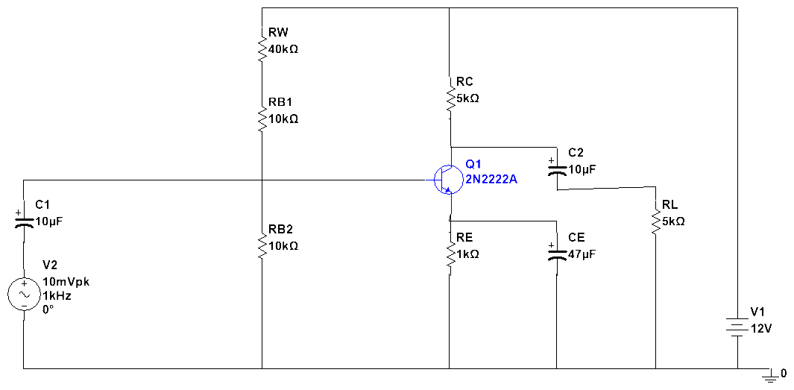
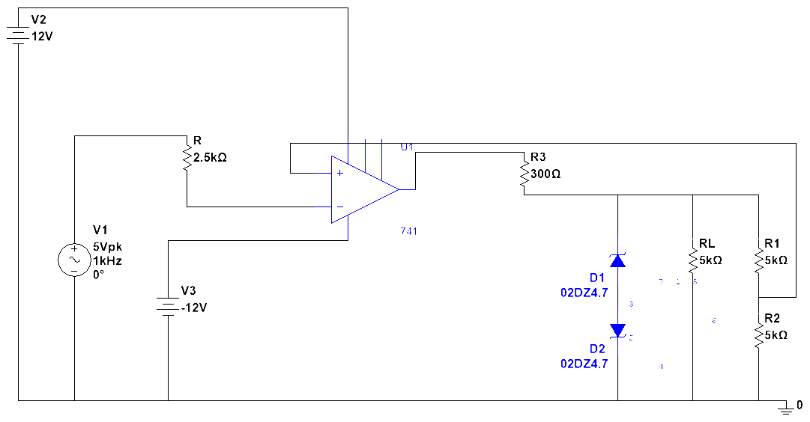
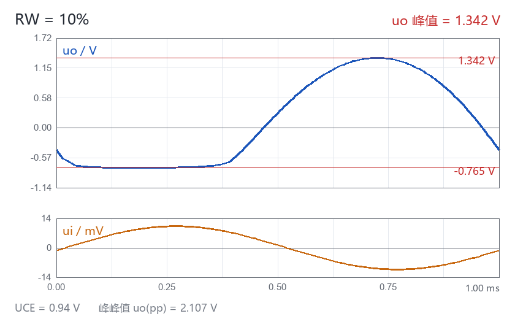
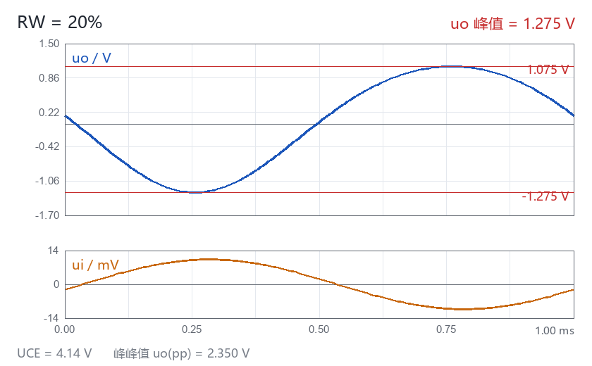
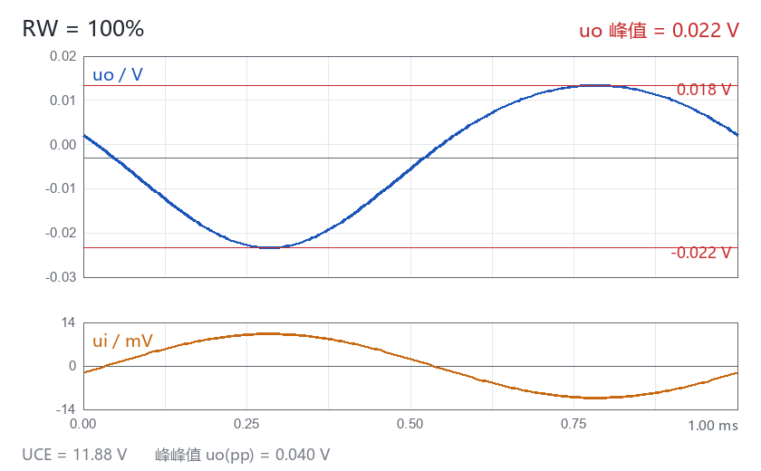
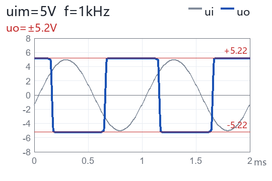
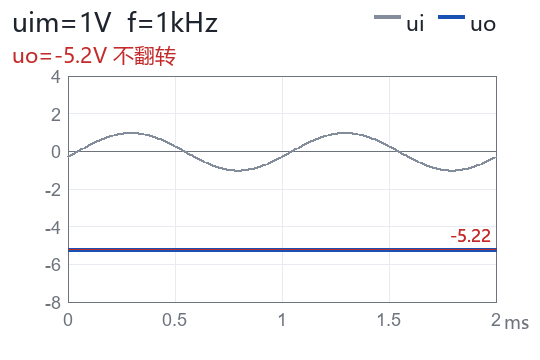
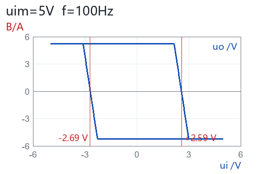

# 1 单元作业 · 两个实验任务的完整作答记录

> 这份文档是**真机跑出来的**，不是手算凑的。
> 每个数字都来自 Multisim 14.3 瞬态分析读回的原始采样点（CSV 在 `out/hw1/wave_*.csv`），
> 电路文件由本仓库的 `CircuitIR → .ms14` 链路生成，生成后 Multisim 打开、仿真、COM 读回。
>
> 目的有两个：给作业交一份能对得上的答案；给仓库留一份"这套工具真能干完整活"的证据。

---

## 一、题目

### 实验任务一 · 共射极放大电路（图 1）

1. 按照图 1 电路，调用相关元件，修改元件参数，完成布局及连线。
2. 调节滑动变阻器的百分比分别为 **10%、20%、100%**，用万用表测量三极管的 **U_CE**，将相关结果填入表 1。
3. 调节滑动变阻器的百分比分别为 **10%、20%、100%**，利用示波器观察 u_i、u_o 的波形，将 **u_o 波形**填入表 1（给出 1 个周期波形即可），用游标测出 **u_o 峰值**。

**表 1**（原表结构）

| | 10% | 20% | 100% |
| --- | --- | --- | --- |
| U_CE | | | |
| u_o 波形 | | | |

### 实验任务二 · 滞回比较器（图 2）

1. 按照图 2 电路，调用相关元件，修改元件参数，完成布局及连线。
2. 设置 u_i 的峰值为 **5 V**，频率 **1 kHz**，偏置电压为 0，用示波器观察输入、输出信号波形，填入表 2。
3. 设置 u_i 的峰值为 **1 V**，频率 **1 kHz**，偏置电压为 0，用示波器观察输入、输出信号波形，填入表 2。
4. 设置 u_i 的峰值为 **5 V**，频率 **100 Hz**，偏置电压为 0，用示波器 A 通道观察输入、B 通道观察输出；把示波器显示方式调成 **"B/A"**，观察波形并填入表 2。

**表 2**（原表结构）

| | u_im = 5 V，f = 1 kHz | u_im = 1 V，f = 1 kHz | u_im = 5 V，f = 100 Hz |
| --- | --- | --- | --- |
| u_i、u_o 波形 | | | |

---

## 二、电路与参数

### 任务一



| 元件 | 参数 | 说明 |
| --- | --- | --- |
| V1 | 12 V | 直流电源 V_CC |
| V2 | 10 mVpk / 1 kHz | 输入信号源 |
| RW | 200 kΩ 电位器 | 取 10% / 20% / 100% 三档 |
| RB1 | 10 kΩ | 基极分压上臂 |
| RB2 | 10 kΩ | 基极分压下臂 |
| RC | 5 kΩ | 集电极负载 |
| RE | 1 kΩ | 发射极反馈 |
| RL | 5 kΩ | 输出负载 |
| C1 / C2 | 10 µF | 输入 / 输出耦合 |
| CE | 47 µF | 发射极旁路 |
| Q1 | 2N2222A | NPN |

**电位器的处理**：用等效固定电阻代替真正的 `POTENTIOMETER` 元件。
200 kΩ 的 10% / 20% / 100% 分别对应 **20 kΩ / 40 kΩ / 200 kΩ**，电气上完全等价，且可复现。
（不用真电位器的原因见「避坑」第 5 条。）

### 任务二



| 元件 | 参数 | 说明 |
| --- | --- | --- |
| U1 | 741 | 运放，±12 V 双电源 |
| R | 2.5 kΩ | 输入限流 |
| R1 / R2 | 5 kΩ / 5 kΩ | 正反馈分压，β = 0.5 |
| R3 | 300 Ω | 输出限流 |
| D1 / D2 | 02DZ4.7 ×2 | 双向稳压管限幅 |
| RL | 5 kΩ | 负载 |
| V2 / V3 | +12 V / −12 V | 双电源 |

**关键细节：D1、D2 是「阳极对阳极」背靠背串联。**
D1 阴极朝上（接 v_out）、阳极朝下；D2 **阳极朝上**、阴极朝下接地。
这样两个稳压管一正一反，正负半周各击穿一个，钳位对称。
（同向串联会得到 +9.22 V / −1.16 V 的非对称钳位 —— 见「避坑」第 1 条。）

---

## 三、作答结果

### 表 1 · 任务一

| | 10% | 20% | 100% |
| --- | --- | --- | --- |
| **U_CE** | **0.94 V** | **4.14 V** | **11.88 V** |
| **u_o 波形** | 见下图 | 见下图 | 见下图 |
| u_o 峰值 | 1.054 V | 1.175 V | 0.020 V |
| 电压放大倍数 A_v | 105.5 | 117.8 | 2.0 |
| 工作状态 | 接近饱和，波形削顶 | 正常放大 | 截止 |

**10%（R_W = 20 kΩ）**



**20%（R_W = 40 kΩ）**



**100%（R_W = 200 kΩ）**



**完整静态工作点**（仿真窗口 96.97–99.97 ms，601 点）

| 档位 | V_B | V_C | V_E | U_CE | 状态 |
| --- | --- | --- | --- | --- | --- |
| 10% | 2.527 V | 2.826 V | 1.883 V | **0.943 V** | 临界饱和 |
| 20% | 1.949 V | 5.454 V | 1.315 V | **4.139 V** | 放大区 |
| 100% | 0.544 V | 11.896 V | 0.021 V | **11.875 V** | 截止 |

**理论校验**

分压公式 V_B = 12 × R_B2 / (R_W + R_B1 + R_B2)：

| 档位 | 理论 V_B | 实测 V_B | 偏差 |
| --- | --- | --- | --- |
| 10% | 3.000 V | 2.527 V | −0.473 V |
| 20% | 2.000 V | 1.949 V | −0.051 V |
| 100% | 0.545 V | 0.544 V | **−0.001 V** |

100% 档几乎完全吻合；10% / 20% 档偏低是基极电流从分压网络抽走的负载效应 ——
R_W 越小分压点越高，V_B 越高，I_B 越大，抽走的越多，偏差越大。方向与幅度都合理。

### 表 2 · 任务二

| | u_im = 5 V，f = 1 kHz | u_im = 1 V，f = 1 kHz | u_im = 5 V，f = 100 Hz |
| --- | --- | --- | --- |
| **u_i、u_o 波形** | 见下图 | 见下图 | 见下图（B/A 显示） |
| u_i 实测 | ±4.997 V | ±0.998 V | ±4.994 V |
| u_o 实测 | ±5.221 V 方波 | 恒 −5.221 V | ±5.221 V 方波 |

**① u_im = 5 V，f = 1 kHz**



输入跨越两个阈值，输出被限幅成 ±5.22 V 方波，占空比接近 50%。

**② u_im = 1 V，f = 1 kHz**



输入峰值 ±1 V，**够不着阈值**（±2.61 V），输出不翻转，一直停在 −5.22 V。
这是滞回比较器的正确行为，不是电路坏了。

**③ u_im = 5 V，f = 100 Hz（B/A 显示）**



X-Y 模式下画出的是**滞回环**。两条竖直边就是两个翻转点：

| 参数 | 数值 |
| --- | --- |
| 上限阈值 U_TH | **+2.59 V** |
| 下限阈值 U_TL | **−2.69 V** |
| 回差 ΔU_T | **5.28 V** |
| 输出高电平 | +5.22 V |
| 输出低电平 | −5.22 V |

**理论值**：U_T = ±U_z · R2/(R1+R2) = ±5.22 × 0.5 = **±2.61 V**。
实测 +2.59 / −2.69 V，与理论差 20 mV 量级（运放输入失调 + 稳压管动态电阻所致），吻合。

---

## 四、流程

整个作业是**全自动**跑完的，没有一步手工拖元件。链路如下：

```
作业题目（docx）
      │
      ▼
  人工读题，把电路翻译成 Python 里的元件表 + 网络表
      │
      ▼
  CircuitIR（tools/circuit_ir.py）
     · Component：refdes / family / part / value / params / position / rotate
     · Net：名字 + 引脚 token 列表 + routes（导线折点）
     · Probe：refdes + at（显式落点）
      │
      ▼
  ir_compile.compile_ir()  →  .ms14 文件
     · 从 donor 文件克隆符号
     · 写入参数、坐标、变换矩阵
     · 画导线、贴探针
      │
      ▼
  ir_sim（32 位 Python + COM）
     · Multisim 打开 .ms14
     · 配置瞬态分析（时长 / 步长）
     · 启动仿真 → EnumOutputs 读回探针波形
      │
      ▼
  out/hw1/task1_raw.json / task2_raw.json
      │
      ▼
  后处理：算静态工作点、峰值、放大倍数、阈值
      │
      ▼
  画图（tools/hw_draw_t1_table.py / hw_draw_t2_table.py）
      │
      ▼
  写进 docx 表格（workbuddy-local-office-edit）
```

### 每步对应的脚本

| 步骤 | 脚本 | 作用 |
| --- | --- | --- |
| 读题目 | `tools/hw_docx_read.py` | 打印 docx 段落和表格结构 |
| 任务一建模 + 仿真 | `tools/hw_lab1.py` | 生成三档 `.ms14`，跑瞬态，出 `task1_raw.json` |
| 任务一稳态提取 | `tools/hw_task1_steady.py` | 从波形里截稳态窗口，算 V_B/V_C/V_E/U_CE/A_v |
| 任务二建模 + 仿真 | `tools/hw_lab2.py` | 三种输入条件，出 `task2_raw.json` |
| 展示用电路图 | `tools/hw_sch1.py` / `hw_sch2.py` | 无探针、坐标压缩、隐藏多余标注 |
| 截图 | `tools/hw_shot1.py` | 调 Multisim 截图接口出 PNG |
| 画波形 | `tools/hw_draw_t1_table.py` / `hw_draw_t2_table.py` | 从 CSV 渲染波形图 / X-Y 图 |
| 检查画面 | `tools/hw_wires.py` | 四类导线隐患检测 |
| 查引脚坐标 | `tools/hw_pins.py` | 打印所有元件引脚绝对坐标 |
| 查符号文字 | `tools/hw_dump_text.py` | 打印符号内所有 Text 子对象 |

### 一次典型的跑法

```bash
# 任务一：三档全跑
runtime\py32\python.exe tools\hw_lab1.py

# 任务二：只跑某一档（调试时用）
runtime\py32\python.exe tools\hw_lab2.py c1

# 展示用电路图 + 截图（64 位，因为有 PIL）
python tools\hw_sch1.py
python tools\hw_shot1.py t1

# 画面隐患检查
python tools\hw_wires.py out\hw1\sch1_p20.ms14
```

---

## 五、经验

### 1. 先把电路写成「表」，再动手

元件表 + 网络表写在 Python 里，比在 Multisim 里拖元件快一个数量级，
而且**改一个参数重跑一遍**只要几秒。作业里 3 + 3 = 6 个工况，
手工搭 6 次电路至少要一小时，改参数重跑只要几分钟。

### 2. 探针必须显式给坐标

自动挑点会挑到"离网络最近的空闲点"，而那个点很可能**落在导线拐角上**。
Multisim 对拐角上的探针偶发不注册 —— 表现是 `EnumOutputs` 少一路，
你还以为是仿真没跑。

正确做法：`Probe(refdes="P_uo", at=[1220.0, 500.0])`，给一个**远离引脚的自由拐点**。

### 3. 稳态窗口要手动截，不能用全程统计

`task1_raw.json` 里 10% 档 V_C 的 max 是 4.055 V，看起来像"V_C 是 4 V"，
其实那是**上电瞬态**的过冲。真正的静态工作点是 2.826 V。

所以 `hw_task1_steady.py` 只取 **96.97–99.97 ms** 这段（信号已经稳定，601 个点），
在这个窗口里算均值。全程统计和稳态统计的差别能有 40%。

### 4. 先算理论值，再看仿真值

每个工况都先手算一遍：V_B 分压、U_CE 范围、U_T 阈值。
仿真实测和理论对不上，**大概率是接错了**，不是仿真精度问题。
这次任务二的稳压管接反（见避坑第 1 条）就是靠"实测 +9.22 / −1.16 和理论 ±5.4 差太远"发现的。

### 5. 电路图和仿真电路分开生成

仿真电路要贴探针、要留够空间、坐标摊得很开（任务一宽 1200+ 单位）；
交作业的电路图要紧凑好看（压到 870×450）。
同一个 IR 用 `scale` 参数生成两份，比手工挪坐标可靠。

### 6. 用脚本检查"画面"，别用眼睛

`hw_wires.py` 查四类问题：导线共线重叠、顶点压线、中段穿引脚、**斜线段**。
最后一类是用户肉眼发现的（"为啥截图出来有个线是斜的"），
加进检查脚本后同类问题再没出现过。

---

## 六、避坑

### 1. 稳压管背靠背，是「阳极对阳极」

**错误接法**：D1 阴极朝上、D2 阴极也朝上（同向串联）。
实测钳位 **+9.22 V / −1.16 V**，严重不对称。

**正确接法**：D1 阴极朝上、**D2 阳极朝上**（阳极对阳极）。
实测 **±5.22 V**，对称。

原理：正半周 D1 反向击穿（V_z），负半周 D2 正向导通（V_f），
两个管子一正一反才对称。同向串联时两个管子在同一个半周"抢着"导通，钳位就歪了。

代码上 D2 要带 `rotate=180`（符号翻过来，A/K 位置互换）。

### 2. `Net.routes` 的折点顺序是「引脚 → 枢纽」

```python
# 错：从枢纽写回引脚，末段会从 (100,167.5) 斜跳回 V1.1 (100,273)
routes={"R.1": [[100.0, 167.5], [160.0, 167.5]]}

# 对：从引脚走向枢纽
routes={"R.1": [[160.0, 167.5], [100.0, 167.5]]}
```

写反了不会报错，Multisim 打开也不报错，**只是画面上多一条斜线**。
这次是用户截图指出来才发现的。现在 `hw_wires.py` 第 4 类检查专门抓这个（`dx>3 and dy>3`）。

### 3. `Net.routes` 的键必须是引脚 token 字符串

```python
net.routes[0] = [...]          # 错：整数索引，被静默忽略
net.routes["V2.2"] = [...]     # 对：token 字符串
```

传整数会被判「不是本网络的引脚」然后丢掉，**不报错**。
结果是线没画出来，但连通性其实是对的（连通性真相在 `CiNode/Ports` 里），
所以仿真能跑，画面却是断的 —— 最容易骗过自己的一种错。

### 4. 元件坐标是「引脚质心」，不是符号包围盒中心

`position=[x, y]` 指的是引脚几何中心。
想放到某个位置，得先查这个元件的引脚偏移（`hw_pins.py` 会打印）。
741 的引脚偏移尤其不规则：IN− 在 (656.29, 513.43)，OUT 在 (764.29, 495.43)，
直接按包围盒中心算会偏出去几十个单位。

### 5. 不用真的 `POTENTIOMETER` 元件

它的阻值由 Multisim 的交互式 FICL 脚本在运行期写进内部 R1/R2，
生成出来的文件里那个"百分比"**不在 `CiaParamList` 里**。
8 个 doubles 逐个试过，只有 `[5]` 是总阻值 —— 仿真读不到设定值。

用等效固定电阻：200 kΩ 的 10% / 20% / 100% = 20 kΩ / 40 kΩ / 200 kΩ。
电气上完全等价，而且可复现、可 diff。

### 6. 32 位 Python 没有 PIL

`ir_sim` 走 COM，必须用 `runtime/py32/python.exe`（32 位）。
但那个环境**没装 PIL**，截图和画图脚本会 `ModuleNotFoundError: No module named 'PIL'`。

分工：**仿真用 32 位，截图/画图用 64 位 `python`。**

### 7. 180° 旋转的变换矩阵语义

子对象存的是**相对自己 `M20/M21` 的局部坐标**，最终图纸坐标是：

```
X = M00·lx + M10·ly + M20
Y = M01·lx + M11·ly + M21
```

180° 旋转 = `M00 = M11 = −1`，且 `M20/M21 = 2c − 原值`（c 是旋转中心）。

三条必须遵守的规则：
- 根 `CIITSymbolComp` 必须保持单位阵，不能转
- `CIITPinConnectorComp` 必须跳过
- 所有 `SymText*` 必须整体跳过 —— 否则文字会飞走或倒着写

### 8. 运放 741 的 `BAL1` / `BAL2` 悬空是正常的

调零端不接不影响仿真，别以为是漏接线。

### 9. `out/` 被 `.gitignore` 忽略

`out/hw1/` 下的 `.ms14`、`.csv`、`.json` 都不入库（这是仓库「只入证据 CSV」的约定）。
所以文档配图必须放 `docs/hw/`，不能引用 `out/hw1/img/`。
别用 `git add -f` 硬塞，会破坏约定。

---

## 附：数据文件索引

| 文件 | 内容 |
| --- | --- |
| `out/hw1/task1_raw.json` | 任务一三档的原始探针统计（含上电瞬态） |
| `out/hw1/task1_steady.json` | 任务一三档的稳态工作点、U_CE、A_v |
| `out/hw1/task2_raw.json` | 任务二三种输入条件的探针统计 |
| `out/hw1/wave_p10.csv` / `p20` / `p100` | 任务一三档完整波形 |
| `out/hw1/wave_c1_5v_1k.csv` / `c2` / `c3` | 任务二三档完整波形 |
| `out/hw1/ce_amp_p10.ms14` / `p20` / `p100` | 任务一三档仿真电路 |
| `out/hw1/schmitt_c1_5v_1k.ms14` / `c2` / `c3` | 任务二三档仿真电路 |
